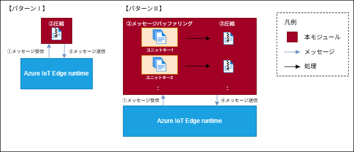
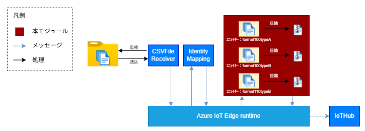

# TransportController

## 目次
* [概要](#概要)
* [機能](#機能)
* [Quick Start](#quick-start)
* [イメージのURL](#イメージのurl)
* [動作保証環境](#動作保証環境)
* [Deployment 設定値](#deployment-設定値)
  * [環境変数](#環境変数)
  * [Desired Properties](#desired-properties)
  * [Create Option](#create-option)
  * [startupOrder](#startuporder)
* [受信メッセージ](#受信メッセージ)
  * [Message Body](#message-body)
  * [Message Properties](#message-properties)
* [送信メッセージ](#送信メッセージ)
  * [Message Body](#SendMessageBody)
  * [Message Properties](#SendMessageProperties)
* [Direct Method](#direct-method)
  * [SetLogLevel](#setloglevel)
  * [GetLogLevel](#getloglevel)
* [ログ出力内容](#ログ出力内容)
* [ユースケース](#ユースケース)
  * [ケース ①](#Usecase1)
  * [ケース ②](#Usecase2)
* [Feedback](#feedback)
* [LICENSE](#license)

## 概要

TransportControllerは、受信したメッセージをプロパティ毎にまとめ、規定経過時間または最大容量に達した時点でメッセージを送信するAzure IoT edgeモジュールです。

## 機能

受信メッセージに対して、圧縮やメッセージバッファリングを用いた送信制御を行いアウトプットに送信する。  

パターンⅠ：受信メッセージを指定の形式で圧縮し、アウトプットに送信する。(メッセージ送信機能 + オプション)  
パターンⅡ：受信メッセージをユニットキーでグループ化し、メッセージバッファリングを用いた送信制御を行う。  
バッファされたメッセージはグループごとに指定の形式で圧縮し、アウトプットに送信する。(メッセージ送信制御機能 + オプション)  



## Quick Start
1. Personal Access tokenを作成
（参考: [個人用アクセス トークンを管理する](https://docs.github.com/ja/authentication/keeping-your-account-and-data-secure/managing-your-personal-access-tokens)）

2. リポジトリをクローン
```
git clone https://github.com/Project-GAUDI/TransportController.git
```

3. ./src/nuget_template.configの<GITHUB_USERNAME>と<PERSONAL_ACCESS_TOKEN>を自身のユーザー名とPersonal Access tokenに書き換えて、ファイル名をnuget.configに変更してください

4. Dockerイメージをビルド
```
docker image build -t <IMAGE_NAME> ./TransportController/src/
```
例）
```
docker image build -t ghcr.io/<YOUR_GITHUB_USERNAME>/transportcontroller:<VERSION> ./TransportController/src/
```

5. Dockerイメージをコンテナレジストリにプッシュ
```
docker push <IMAGE_NAME>
```
例）
```
docker push ghcr.io/<YOUR_GITHUB_USERNAME>/transportcontroller:<VERSION>
```

6. Azure IoT edgeで利用

## イメージのURL
準備中
| URL                                                                 | Description         |
| ------------------------------------------------------------------- | ------------------- |

## 動作保証環境

| Module Version | IoTEdge | edgeAgent | edgeHub | amd64 verified on | arm64v8 verified on | arm32v7 verified on |
| -------------- | ------- | --------- | ------- | ----------------- | ------------------- | ------------------- |
| 7.1.0          | 1.6.4   | 1.6.4     | 1.6.4   | ubuntu24.04       | －                  | －                  |

## Deployment 設定値

### 環境変数

#### 環境変数の値

| Key               | Type   | Required | Conditions                                  | Default | Description                     |
| ----------------- | ------ | -------- | ------------------------------------------- | ------- | ------------------------------- |
| TransportProtocol | string |          | ["Amqp", "Mqtt"]                            | Amqp    | ModuleClient の接続プロトコル。 |
| LogLevel          | string |          | ["trace", "debug", "info", "warn", "error"] | info    | 出力ログレベル。                |

### Desired Properties

#### Desired Properties の値

| JSON Key         | Type    | Required | Conditions                                           | Default | Description                                                                                                                                                                                                                                                                                                                                                                                                                                                                                    |
| ---------------- | ------- | -------- | ---------------------------------------------------- | ------- | ---------------------------------------------------------------------------------------------------------------------------------------------------------------------------------------------------------------------------------------------------------------------------------------------------------------------------------------------------------------------------------------------------------------------------------------------------------------------------------------------- |
| input            | string  |          |                                                      | input   | メッセージを受信するインプット名。                                                                                                                                                                                                                                                                                                                                                                                                                                                             |
| output           | string  |          |                                                      | output  | メッセージを送信するアウトプット名。                                                                                                                                                                                                                                                                                                                                                                                                                                                           |
| compress         | string  |          | ["gzip","deflate","none"]                            | none    | メッセージ圧縮形式。<br>bodyのみが対象。<br>gzip：gzip形式で圧縮<br>deflate：deflate形式で圧縮<br>none：圧縮なし                                                                                                                                                                                                                                                                                                                                                                               |
| transportcontrol | boolean | 〇       | [true,false]                                         |         | メッセージ送信制御機能の有効可否。<br>true：GAUDI標準形式メッセージのみを対象としバッファリングを実施<br>false：メッセージのバッファリングを実施しない                                                                                                                                                                                                                                                                                                                                         |
| bandwidthcontrol | boolean | △        | transportcontrol=true時必須<br>[true,false]          |         | 帯域制御機能の有効可否。<br>メッセージバッファリング中に、バッファがsendsizemaxのサイズを超える場合の動作を指定する。<br>true：超過分を破棄<br>false：バッファした分までをメッセージ送信し、超過分を新たにバッファリング                                                                                                                                                                                                                                                                       |
| sendsizemax      | number  | △        | transportcontrol=true時必須<br>1以上256000以下の整数 |         | メッセージのバッファリング最大サイズ（バイト）。<br>圧縮前のサイズを設定する。                                                                                                                                                                                                                                                                                                                                                                                                                 |
| sendcycle        | number  | △        | transportcontrol=true時必須<br>1以上の整数           |         | メッセージの送信間隔（ミリ秒）。<br>unitkeyごとにグルーピングされたメッセージの最初の受信からsendcycle経過ごとにバッファ中の<br>メッセージを送信する。                                                                                                                                                                                                                                                                                                                                         |
| unitkey          | string  |          |                                                      | null    | メッセージをバッファリングする際のグルーピングキー。<br>プロパティのキー名をカンマ区切りで設定する。<br>設定方法の仕様上、カンマを含むキー名は設定できない。<br>受信メッセージのプロパティから設定したキー名と値を抽出して結合した文字列をユニットキーとし、<br>メッセージのグルーピングに使用する。<br>受信メッセージのプロパティから設定したキー名に対応する値が取得できない場合は、その値を<br>空文字で処理する。<br>未設定の場合は、全てのメッセージを同一のグループでバッファリングする。 |

#### Desired Properties の記入例

```json
{
  "input": "input",
  "output": "output",
  "compress": "gzip",
  "transportcontrol": true,
  "bandwidthcontrol": false,
  "sendsizemax": 3000,
  "sendcycle": 1000,
  "unitkey": "format,data_type,free_area,settingFileKey,productionMode"
}
```

### Create Option

#### Create Option の値

| JSON Key            | Type   | Required | Description            |
| ------------------- | ------ | -------- | ---------------------- |
| HostConfig          | object | 〇       |                        |
| &emsp; Mounts       | array  | 〇       | マウント設定。         |
| &emsp;&emsp; Type   | string | 〇       | マウント種別。         |
| &emsp;&emsp; Source | string | 〇       | マウント元。           |
| &emsp;&emsp; Target | string | 〇       | コンテナ内マウント先。 |

#### バッファ退避用データボリューム

終了時に未送信メッセージが存在する場合、`/app/backupdata/{ModuleId}_{unitkey}_backup.json`へユニットキーごとに退避される。  
次回起動時に復元して再送信を試みるため、データボリュームをマウントする。  
`{ModuleId}`は自動取得されるモジュール名、`{unitkey}`はメッセージのグルーピングに使用するユニットキーである。  
モジュールツインのunitkey未設定時は、`{unitkey}`が`sunit`固定となる。  
※モジュールを使用する上で必須ではないがメッセージロストを防ぐため、設定することを推奨する。

* Type：`volume`を指定。
* Source：ボリューム名。
* Target：`/app/backupdata`固定。

記入例：

```json
{
  "HostConfig": {
    "Mounts": [
      {
        "Type": "volume",
        "Source": "backupdata",
        "Target": "/app/backupdata"
      }
    ]
  }
}
```

### startupOrder

#### startupOrder の値

| JSON Key     | Type   | Required | Conditions                   | Default    | Recommend | Description                                            |
| ------------ | ------ | -------- | ---------------------------- | ---------- | --------- | ------------------------------------------------------ |
| startupOrder | number |          | 0 以上 4294967295 以下の整数 | 4294967295 | 400       | モジュールの起動順序。数字が小さいほど先に起動される。 |

#### startupOrder の記入例

```json
{
  "startupOrder": 400
}
```

## 受信メッセージ

### Message Body

任意  
ただし、モジュールツインのtransportcontrol=trueの場合は、GAUDI標準形式メッセージのみを対象とする。

### Message Properties

任意

### Message の例

例はGAUDI標準形式メッセージ。

```json
{
  "Body": {
    "RecordList":[
      {
        "RecordHeader":["testA1.CSV","1"],
        "RecordData":["A1","0110","838367"]
      }
    ]
  },
  "Properties": {
    "format":"100",
    "data_type":"A"
  }
}
```

## 送信メッセージ

<a id="SendMessageBody"></a>

### Message Body

受信したメッセージのbodyを、モジュールツインのcompressの設定に従って圧縮して送信する。

<a id="SendMessageProperties"></a>

### Message Properties

受信したメッセージのプロパティに下記を加える。  
※モジュールツインのcompressの設定がtrueでも圧縮はされない。

| Key               | Description                          |
| ----------------- | ------------------------------------ |
| iotedge_timestamp | 現在日時 ("yyyy-MM-dd HH:mm:ss.fff") |

### Message の例

```json
{
  "Body": {
    "RecordList":[
      {
        "RecordHeader":["testA1.CSV","1"],
        "RecordData":["A1","0110","838367"]
      }
    ]
  },
  "Properties": {
    "format":"100",
    "data_type":"A",
    "iotedge_timestamp":"2020-08-05 14:00:01.000"
  }
}
```

## Direct Method

### SetLogLevel

* 機能概要

  実行中に一時的にLogLevelを変更する。<br>
  変更はモジュール起動中または有効時間を過ぎるまで有効。<br>

* payload

  | JSON Key      | Type    | Required | default | Description |
  | ------------- | ------- | -------- | -------- | ----------- |
  | EnableSec     | integer  | 〇       |          | 有効時間(秒)。<br>-1:無期限<br>0:リセット(環境変数LogLevel相当に戻る)<br>1以上：指定時間(秒)経過まで有効。  |
  | LogLevel      | string  | △       |          | EnableSec=0以外を指定時必須。指定したログレベルに変更する。<br>["trace", "debug", "info", "warn", "error"]  |

  １時間"trace"レベルに変更する場合の設定例

  ```json
  {
    "EnableSec": 3600,
    "LogLevel": "trace"
  }
  ```

* response

  | JSON Key      | Type    | Description |
  | ------------- | ------- | ----------- |
  | status          | integer | 処理ステータス。<br>0:正常終了<br>その他:異常終了         |
  | payload          | object  | レスポンスデータ。         |
  | &nbsp; CurrentLogLevel | string  | 設定後のログレベル。（正常時のみ）<br>["trace", "debug", "info", "warn", "error"]  |
  | &nbsp; Error | string  | エラーメッセージ（エラー時のみ）  |

  ```json
  {
    "status": 0,
    "paylaod":
    {
      "CurrentLogLevel": "trace"
    }
  }
  ```

### GetLogLevel

* 機能概要

  現在有効なLogLevelを取得する。<br>
  通常は、LogLevel環境変数の設定値が返り、SetLogLevelで設定した有効時間内の場合は、その設定値が返る。<br>

* payload

  なし

* response

  | JSON Key      | Type    | Description |
  | ------------- | ------- | ----------- |
  | status          | integer | 処理ステータス。<br>0:正常終了<br>その他:異常終了         |
  | payload          | object  | レスポンスデータ。         |
  | &nbsp; CurrentLogLevel | string  | 現在のログレベル。（正常時のみ）<br>["trace", "debug", "info", "warn", "error"]  |
  | &nbsp; Error | string  | エラーメッセージ（エラー時のみ）  |

  ```json
  {
    "status": 0,
    "paylaod":
    {
      "CurrentLogLevel": "trace"
    }
  }
  ```

## ログ出力内容

| LogLevel | 出力概要                                                                                                                                                                                                                                                                                       |
| -------- | ---------------------------------------------------------------------------------------------------------------------------------------------------------------------------------------------------------------------------------------------------------------------------------------------- |
| error    | [初期化/リソース解放/モジュールツイン更新/メッセージ送信/メッセージ受信]失敗<br>メッセージ送信タイムアウト<br>送信失敗の再試行回数(RetryCount: 現在回数/上限回数)<br>送信失敗回数が上限に到達<br>モジュールツインの必須項目未設定<br>[環境変数/モジュールツイン]がConditionsまたはType制約違反 |
| warn     | エッジランタイムとの接続リトライ失敗                                                                                                                                                                                                                                                           |
| info     | [環境変数/モジュールツイン]の値<br>モジュールツイン更新通知<br>[環境変数/モジュールツイン]の省略可能項目未設定のためDefault値適用<br>メッセージ[送信/受信]通知<br>メッセージをバッファに追加<br>レコードを切り捨て(bandwidthcontrol=true時)                                                    |
| debug    | メッセージバッファのカウント<br>前回の送信処理継続中のため送信サイクル処理をスキップ                                                                                                                                                                                                           |
| trace    | リソース解放済み通知<br>メソッドの開始・終了<br>受信メッセージBody                                                                                                                                                                                                                             |

## ユースケース

<a id="Usecase1"></a>

### ケース ①

アップロードされるCSVのデータをバッファリングし、圧縮してIoTHubに送信する。  
sendcycleの送信間隔に至ったため送信する。  



#### 起動順序 startupOrder

| 名称         | 値  |
| ------------ | --- |
| startupOrder | 400 |

#### 環境変数

| 名称     | 値    |
| -------- | ----- |
| LogLevel | debug |

#### コンテナーの作成オプション Create Option

```json
{
  "HostConfig": {
    "Mounts": [
      {
        "Type": "volume",
        "Source": "backupdata",
        "Target": "/app/backupdata"
      }
    ]
  }
}
```

#### モジュールツインの設定

```json
{
  "input": "input",
  "output": "output",
  "compress": "gzip",
  "transportcontrol": true,
  "bandwidthcontrol": false,
  "sendsizemax": 3000,
  "sendcycle": 60000,
  "unitkey": "format,type"
}
```

<a id="buffer1"></a>

#### バッファ済みレコード

過去の受信メッセージから、ユニットキー3種類のレコード7つがバッファ済み。

| No. | 受信時刻 | ユニットキー(format,type) | ユニットキー起点 | Body.RecordList[0].RecordData[0] |
| --- | -------- | ------------------------- | ---------------- | -------------------------------- |
| 1   | 14:00:00 | format100typeA            | 〇               | A1                               |
| 2   | 14:00:01 | format100typeB            | 〇               | B1                               |
| 3   | 14:00:02 | format100typeA            |                  | A2                               |
| 4   | 14:00:05 | format110typeA            | 〇               | A3                               |
| 5   | 14:00:10 | format100typeB            |                  | B2                               |
| 6   | 14:00:11 | format100typeB            |                  | B3                               |
| 7   | 14:00:17 | format110typeA            |                  | A4                               |

#### 受信メッセージ

##### Body

```json
  {
    "RecordList":[
      {
        "RecordHeader":["testA5.CSV","1"],
        "RecordData":["A5","0135","840367"]
      }
    ]
  }
```

##### Properties

下記からユニットキーは"format100typeA"となる。

```json
  {"format":"100","type":"A"}
```

#### 出力結果

ユニットキーごとにバッファリングし、初受信から1分後に、バッファ済みレコードをgzip圧縮して送信する。  

##### 出力1_ユニットキーがformat100typeA

受信メッセージと[バッファ済みレコード](#buffer1)のformat100typeAレコード合計3つを1つのメッセージにして送信する。  
送信時刻：14:01:00 (sendcycle=60000より)

###### Body

以下を圧縮して送信する。

```json
  {
    "RecordList":[
      {
        "RecordHeader":["testA1.CSV","1"],
        "RecordData":["A1","0110","838367"]
      },
      {
        "RecordHeader":["testA2.CSV","1"],
        "RecordData":["A2","0115","838371"]
      },
      {
        "RecordHeader":["testA5.CSV","1"],
        "RecordData":["A5","0360","838387"]
      }
    ]
  }
```

###### Properties

以下は圧縮されない。

```json
  {"format":"100","type":"A","iotedge_timestamp":"2020-08-05 14:01:00.000"}
```

##### 出力2_ユニットキーがformat100typeB

[バッファ済みレコード](#buffer1)のformat100typeBレコード3つを1つのメッセージにして送信する。  
送信時刻：14:01:01 (sendcycle=60000より)

###### Body

以下を圧縮して送信する。

```json
  {
    "RecordList":[
      {
        "RecordHeader":["testB1.CSV","1"],
        "RecordData":["B1","0110","838367"]
      },
      {
        "RecordHeader":["testB2.CSV","1"],
        "RecordData":["B2","0115","838371"]
      },
      {
        "RecordHeader":["testB3.CSV","1"],
        "RecordData":["B3","0120","838375"]
      }
    ]
  }
```

###### Properties

以下は圧縮されない。

```json
  {"format":"100","type":"B","iotedge_timestamp":"2020-08-05 14:01:01.000"}
```

##### 出力3_ユニットキーがformat110typeA

[バッファ済みレコード](#buffer1)のformat110typeAレコード2つを1つのメッセージにして送信する。  
送信時刻：14:01:05 (sendcycle=60000より)

###### Body

以下を圧縮して送信する。

```json
  {
    "RecordList":[
      {
        "RecordHeader":["testA3.CSV","1"],
        "RecordData":["A3","0110","838367"]
      },
      {
        "RecordHeader":["testA4.CSV","1"],
        "RecordData":["A4","0130","898375"]
      }
    ]
  }
```

###### Properties

以下は圧縮されない。

```json
  {"format":"110","type":"A","iotedge_timestamp":"2020-08-05 14:01:05.000"}
```

<a id="Usecase2"></a>

### ケース ②

アップロードされるCSVのデータをバッファリングし、圧縮してIoTHubに送信する。  
受信メッセージのレコードをバッファリング中にsendsizemaxのサイズを超えるため、  
sendcycleの送信間隔に至る前にバッファ済みレコードを送信する。  


#### 起動順序 startupOrder

| 名称         | 値  |
| ------------ | --- |
| startupOrder | 400 |

#### 環境変数

| 名称     | 値    |
| -------- | ----- |
| LogLevel | debug |

#### コンテナーの作成オプション Create Option

```json
{
  "HostConfig": {
    "Mounts": [
      {
        "Type": "volume",
        "Source": "backupdata",
        "Target": "/app/backupdata"
      }
    ]
  }
}
```

#### モジュールツインの設定

```json
{
  "input": "input",
  "output": "output",
  "compress": "gzip",
  "transportcontrol": true,
  "bandwidthcontrol": false,
  "sendsizemax": 450,
  "sendcycle": 60000,
  "unitkey": "format,type"
}
```

<a id="buffer2"></a>

#### バッファ済みレコード

過去の受信メッセージから、100バイトのレコード3つがバッファ済み。

| No. | 受信時刻 | ユニットキー(format,type) | レコードサイズ(バイト) | Body.RecordList[0].RecordData[0] |
| --- | -------- | ------------------------- | ---------------------- | -------------------------------- |
| 1   | 14:00:00 | format100typeA            | 100                    | A1                               |
| 2   | 14:00:00 | format100typeA            | 100                    | A2                               |
| 3   | 14:00:00 | format100typeA            | 100                    | A3                               |

バッファ済みレコードの合計サイズは300バイト。

#### 受信メッセージ

##### Body

サイズが100バイトのレコードが3つのメッセージを14:00:10に受信する。

```json
  {
    "RecordList":[
      {
        "RecordHeader":["testA2.CSV","1"],
        "RecordData":["A4","0140","840000"]
      },
      {
        "RecordHeader":["testA2.CSV","2"],
        "RecordData":["A5","0150","850000"]
      },
      {
        "RecordHeader":["testA2.CSV","3"],
        "RecordData":["A6","0160","860000"]
      }
    ]
  }
```

##### Properties

```json
  {"format":"100","type":"A"}
```

#### 出力結果

受信メッセージの2つ目のレコードをバッファするとバッファのサイズが500バイトになりsendsizemax(450)を超えるため、  
sendcycleの送信間隔に至る前にバッファ済みレコードをgzip圧縮して送信する。

##### 出力_ユニットキーがformat100typeA

受信メッセージの1つ目のレコードと[バッファ済みレコード](#buffer2)のレコード合計4つを1つのメッセージにして送信する。

###### Body

以下を圧縮して送信する。

```json
  {
    "RecordList":[
      {
        "RecordHeader":["testA1.CSV","1"],
        "RecordData":["A1","0110","810000"]
      },
      {
        "RecordHeader":["testA1.CSV","2"],
        "RecordData":["A2","0120","820000"]
      },
      {
        "RecordHeader":["testA1.CSV","3"],
        "RecordData":["A3","0130","830000"]
      },
      {
        "RecordHeader":["testA2.CSV","1"],
        "RecordData":["A4","0140","840000"]
      }
    ]
  }
```

###### Properties

以下は圧縮されない。

```json
  {"format":"100","type":"A","iotedge_timestamp":"2020-08-05 14:00:10.000"}
```

##### メッセージ送信後のバッファ済みレコード

メッセージ送信後に、受信メッセージから残りの未送信レコードをバッファリングする。

| No. | 受信時刻 | ユニットキー(format,type) | レコードサイズ(バイト) | Body.RecordList[0].RecordData[0] |
| --- | -------- | ------------------------- | ---------------------- | -------------------------------- |
| 1   | 14:00:10 | format100typeA            | 100                    | A5                               |
| 2   | 14:00:10 | format100typeA            | 100                    | A6                               |

バッファ済みレコードの合計サイズは200バイト。

## Feedback
お気づきの点があれば、ぜひIssueにてお知らせください。

## LICENSE
This project is licensed under the MIT License, see the [LICENSE](LICENSE) file for details.
